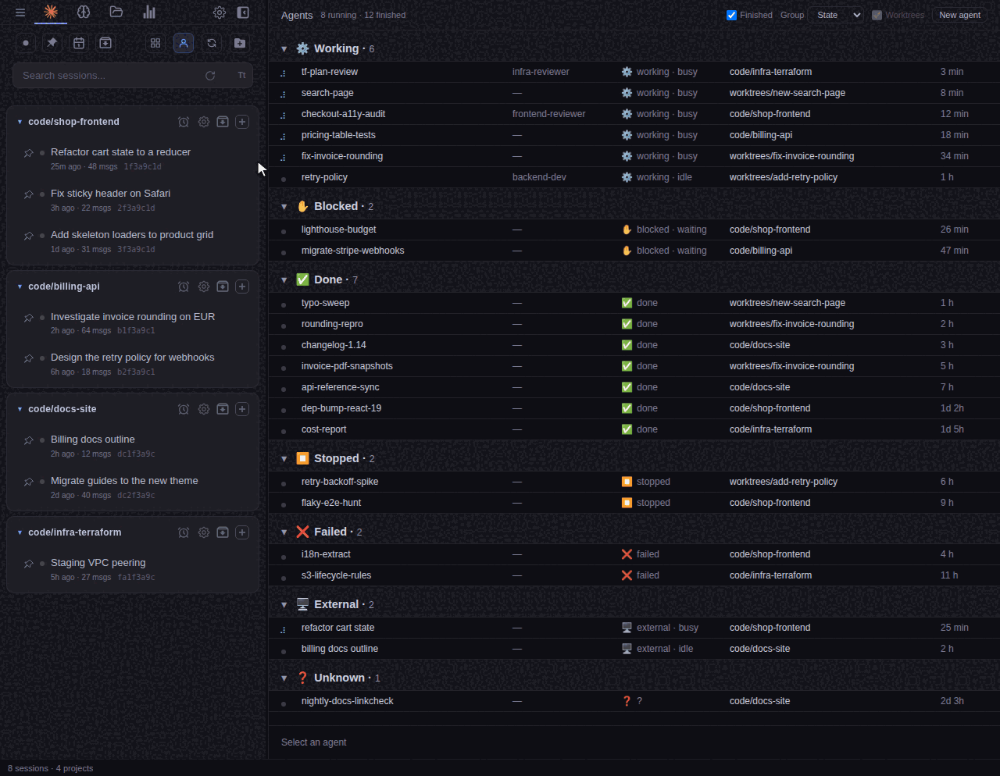

# Background agents

The Agents view is Switchboard's replacement for the `claude agents` TUI: it
lists the sessions the Claude CLI daemon runs in the background
(`claude --bg`) and the interactive `claude` sessions running outside this
Switchboard, and acts on them without a terminal.

## Opening it

The people icon in the sidebar's filter row, or `Ctrl+Shift+A` (`Cmd+Shift+A`
on macOS; [rebindable](keyboard-shortcuts.md)). The same toggle closes it and
brings back whatever was there: the grid, the active session, or the
placeholder. Opening any other view (Agent Files, Work Files, Settings, the
grid, Stats) closes it. Whether the view is open is remembered across
restarts.

## The list

One row per background job or external interactive session: an activity glyph shared with the sidebar — an animated
spinner during a turn, a static spinner for background tasks at the prompt,
an orange hollow ring while waiting (including blocked jobs), a blinking orange
LED with a halo for Needs your attention, a blue dot for a response ready, a green dot for a session open
in one of Switchboard's own tabs (an attach tab included) at rest, or a dim grey
dot when finished — its name, its `--agent`, its state emoji and job state (see the
table below), its directory, and its age. Every state column uses Title Case,
without the raw descriptor status: Active, Blocked, Idle, Done, Stopped, Failed,
External or Unknown. Screen readers announce the activity glyph's status.
Active and blocked jobs and external interactive sessions come first, newest
first. **Finished** shows or hides `done`, `stopped` and `failed` sessions;
the choice is remembered. The header counts `running` and `finished` background
sessions, then `N external` when the list holds external sessions (these are
always shown). A session running in one of Switchboard's own tabs is not listed
as external once the app has read the process list, which can take a second or
two after start-up or after a tab opens. The list refreshes when the daemon's files change,
and is re-read from the CLI every 30 seconds while the view is open.

**Group**, next to Finished, splits the list into sections with a header
each (its name and how many rows it holds):

- **State** (the default): Active, Blocked, Idle, Done, Stopped, Failed, then
  External for the interactive sessions running outside Switchboard, then
  Unknown. Each header starts with the state's emoji.
- **None**: one flat list.
- **Project**: one section per project, named after its folder (hover the
  header for the full path; two projects with the same folder name show
  their parent folder too). All the worktrees of one git project — the
  `.claude/worktrees/<name>` ones as well as any `git worktree add`
  directory, and any subdirectory of them — fall under the project's main
  checkout. A directory that is not in a git repository is its own project.
  Projects with something running come first, then the rest alphabetically;
  sessions without a directory go under No project.

**Worktrees**, next to Group (checked by default, remembered), adds a second
level in Project mode: inside a project, one smaller sub-header per worktree
with its own count — **main** for the main checkout, the worktree's folder
name for the others (hover for the full path). Sub-headers only appear for a
project whose sessions run in more than one worktree; a project that lives in
a single worktree stays a flat list under its header. Worktrees with
something running come first, then main, then the others alphabetically. The
box is greyed out in the other modes.

Click a header (or focus it and press Enter or Space) to fold its section:
the header keeps its name and count, its rows are hidden; folding a project
hides its worktree sub-sections too. The arrow at the start of the header
shows which sections are folded. It works in every grouping, each grouping
remembers its own folded sections, and they stay folded across refreshes and
restarts. A selected session in a folded section stays selected.

Rows keep their usual order inside a section, the Finished filter applies
first (a section left empty is not shown), and the choice is remembered.

A job is in one of five states: `working`, `blocked` (live, waiting for
input), `done`, `stopped` or `failed` (ended in error). `working` and
`blocked` count as hosted. A done job with a matching live background descriptor
also stays hosted and displays Idle. Descriptor-free done is finished; stopped
and failed are always unhosted. A finished job without a live descriptor has
the activity tooltip Not running, in Agents, the sidebar and the grid. Without
a terminal job state or a live descriptor, it reads Liveness unknown: missing
files alone do not establish that a process has ended.

A blocked job has parked itself, for example during a quota pause or while
awaiting your go-ahead. It shows the static orange waiting ring in the sidebar,
grid and Agents view, including while attached, and keeps its Blocked label
and tooltip. A separate attention notification or a live descriptor explicitly
requesting attention still makes it blink. When the job leaves `blocked`, its
icon follows its current activity again.

The same emoji marks a state in the State headers and at the start of every
row's state column, whatever the grouping:

| Emoji | State |
|---|---|
| ⚙️ | Active (job `working`) |
| ✋ | Blocked (waiting for input) |
| 💤 | Idle (done job with a live background descriptor) |
| ✅ | Done |
| ⏹️ | Stopped |
| ❌ | Failed |
| 🖥️ | External (an interactive session outside Switchboard) |
| ❓ | Unknown |

Selecting a row opens its detail: the daemon's one-line status, tokens,
model, start time, pid, the subagents it ran, the links it produced (merge
requests open in the browser), its last result, and the verbs:

| Verb | Runs | Available |
|---|---|---|
| Resume | opens the conversation here after the shared live-elsewhere question | an External interactive session with a session id |
| Attach | `claude attach <id>` in a terminal tab | while hosted (working, blocked, or done with a matching live background descriptor) and the daemon answers |
| Transcript | the read-only transcript viewer | whenever the transcript exists |
| Stop | `claude stop <id>`, after confirmation naming the job and id; its process ends and the conversation is kept | while live |
| Respawn | `claude respawn <id>` | a background session that is not live |
| Delete | `claude rm <id>`, after confirmation; the worktree goes too when that is safe | a background session that is not live |

A finished job whose conversation is still running interactively appears as
one live External row, keeping its job details, id and finished state. It remains
visible when Finished is unchecked and still counts as finished. A conversation
open in this Switchboard keeps its job row. Respawn and Delete are disabled in
both cases; hover them to see the pid and where the conversation is open.
For a conversation open here, the message directs you to Stop on its sidebar
row. For one running in another process, it asks you to end that process first.

An external interactive session offers **Resume** and **Transcript**. Resume
uses the same question as a sidebar click: **Resume anyway** starts a second
Claude on the conversation, with both writing to its transcript; **Cancel**
opens nothing. A conversation already open in this window is shown directly.
Live background jobs still use Attach. To respawn or delete a conversation,
stop it from its sidebar row if it is open here, or end its other process first.
Switchboard checks again before Respawn or Delete, and before Stop on a
finished job. A conversation held by an open terminal or another live process
is refused even if the job says stopped or done. If the process or job files
cannot be read, the action is refused with a reason. Stop remains available
for a working or blocked daemon job, including when its job file is missing or
its fresh state is unknown. A refused Stop keeps an attached tab open.

Stop and Delete check whether they can proceed before asking for confirmation.
A refusal appears in the detail pane without a dialog. Cancel stops or deletes
nothing. After confirmation, Switchboard checks again before running the command;
a conversation that started running while the dialog was open can still refuse.

Transcript checks the session index when clicked and shows a reason if the file
is missing or not indexed yet. Click again after indexing to open it. A file
removed after this check produces an error in the read-only viewer.

## Send to background

A conversation moved with a typed `/bg` keeps its name and one sidebar row across
restarts, including when the original transcript receives later bookkeeping.
This requires a command observed by this tab's composer and a proven single
continuation; unobserved slash-menu/history input and genuinely ambiguous
branches retain their existing limits. The button's automatic conversion to an
attach tab remains a separate attachment behavior.

Use **Send to background** in a running session's header or its sidebar
right-click menu to move it to the Claude daemon. The tab becomes an attached
tab under the continuing conversation's new id. Closing it detaches it;
the session keeps running. While the tab stays open it is saved for restore,
so Switchboard reattaches it after each restart.

Send or clear any unsubmitted prompt first, and answer any open terminal
dialog. The action is unavailable for plain terminals, remote sessions,
sandboxed sessions and sessions started through a pre-launch command.
Switchboard also refuses when it cannot read Claude's state, and while Claude
is working: send it to the background once it is idle. If subagents are running,
Switchboard asks before sending: Claude may stop them during the move.
If Claude asks for confirmation in the terminal, answer Background or Stay
there; Switchboard does not answer that dialog for you.

An unconfirmed move displays a notice with what to check. If the terminal
has exited, open the conversation from the sidebar to check where it runs.
If attaching fails after the move, the session still runs in the background;
open it from the sidebar to attach again. A confirmed typed `/bg` move uses the
same continuation and metadata persistence as the toolbar action.

## Attaching

Double-click a row you can attach to (a hosted working/blocked or hosted done session,
with the daemon answering) to attach, the same as the **Attach** button in the
detail pane. A double click on a finished or external session, on a group
header or on a button does nothing extra.

An attach tab is an ordinary terminal tab running `claude attach`. Its row shows
the green dot until Switchboard sees a turn end in that tab, then the orange
ring. Its stop
button reads **Detach**: it sends Ctrl+Z without asking, the attach client
leaves, and the session keeps running under the daemon. A notice offers
**Undo** for about 10 seconds to attach it again in the same working folder.
If the client is still closing, Undo waits for it to leave before reattaching.
Stopping the session
is only offered in the Agents view. Tabs created by Send to background or
background continuation restore are reopened by [session restore](session-restore.md);
ordinary attach tabs are not. Quitting Switchboard or closing its
window ends the attach client without the Ctrl+Z; the session still keeps
running.

A click in the sidebar on a session the daemon is running attaches to it
instead of asking to resume it. Once the Agents view has been opened, such a
row carries a `bg` badge while the job is live; the badge goes when the job
finishes, and a finished background session resumes like any other.

## New agent

**New agent** opens a dialog: prompt, project, name (`--name`), agent
(`--agent`), permission mode or Dangerous Skip, additional directories. It
runs `claude --bg …` in the project directory and selects the new row. A
prompt starting with `-` is refused, since the CLI would read it as a flag.

The permission mode, Dangerous Skip and additional directories are filled from
the chosen project's settings, and filled again when you pick another project.
Remote projects are not offered: the agent runs on this machine.

A project that runs its sessions sandboxed, or that has a pre-launch command,
cannot start a background agent: the daemon starts the agent itself, outside
the sandbox and without the pre-launch command. The dialog says so and Start
stays disabled; start a session in that project instead.

A session that a background job is still running cannot be archived or
deleted from the sidebar: stop the job from the Agents view first. Archiving
a folder that holds one is refused when **Archive the sessions** is checked.
Unchecked, the folder is only hidden: no session is archived or detached, and
the job keeps running and stays in the Agents view. A session live in another
process cannot be deleted either. When Switchboard cannot tell, for example because `~/.claude/jobs`
cannot be read, it refuses and says why.

## When the daemon does not answer

The view reads two files the CLI writes for itself, `~/.claude/jobs/<id>/state.json`
and `~/.claude/sessions/<pid>.json`, alongside `claude agents --json --all`.
The list combines CLI entries, cached jobs and live background descriptors. A
successful listing that omits a cached job does not erase its available activity
or disable its usual verbs while the daemon answers. When the command fails,
a banner says so and the file-backed candidates remain. Background job verbs are disabled; Transcript
and Resume on an External row remain available.
Neither file is a documented interface; a CLI upgrade may change them, and
`test/canary-bg-agents-files.test.js` says so when it happens.

At most 200 job directories are watched. This cap does not limit CLI or live
descriptor candidates in the combined list.

A proven conversation keeps its parts through temporary descriptor gaps,
including a finished background continuation. Hosting controls the bg marker and
Attach/Stop; attachment and current identity proof control which part represents
the conversation. Sidebar conversation Delete includes every proved part and
checks each for running/unknown processes and actual transcript targets. It is
distinct from the Agents daemon Delete (`rm`) operation.
